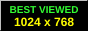
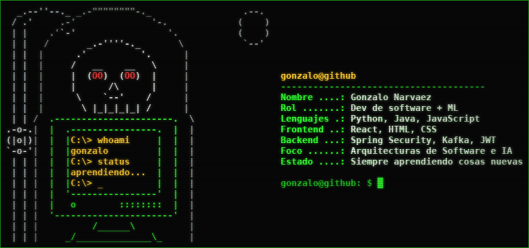

<div align="center">




<br>




<br><br>


<br><br>


</div>

<br>


<div align="center">



</div>

<details>
<summary>Ver los datos en texto</summary>

```text
  .----------------.     gonzalo@github
  | .------------. |     --------------------------------------
  | | C:\> hola_ | |     Nombre ....: Gonzalo Narvaez
  | |            | |     Rol .......: Dev de software + ML
  | |            | |     Lenguajes .: Python, Java, JavaScript
  | '------------' |     Frontend ..: React, HTML, CSS
  '--.----------.--'     Backend ...: Spring Security, Kafka, JWT
   _/____________\_      Foco ......: Arquitecturas de Software e IA
  /________________\     Estado ....: Siempre aprendiendo cosas nuevas
```

**Arte en braille**

```text
⠀⠀⠀⠀⠀⠀⠀⠀⠀⠀⠀⠀⠀⠀⠀⠀⠀⠀⠀⠀⠀⠀⠀⠀⠀⠀⠀⠀⠀⠀⠀⠀⠀⠀⠀⠀⠀⠀⠀⠀⠀⠀⡀⠀⠀⠀⠀⠀⠀⠀⠀⠀⠀⠀⠀⠀⠀⠀⠀⠀⠀⠀⠀⠀⠀⠀⠀⠀⠀
⠀⠀⠀⠀⠀⠀⠀⠀⠀⠀⠀⠀⠀⠀⠀⠀⠀⠀⠀⠀⠀⠀⠀⠀⠀⠀⠀⠀⠀⠀⠀⠀⠀⠀⠈⠀⠀⠀⠀⠀⠀⠀⠀⠀⠀⠀⠀⠀⠀⠀⠀⠀⠀⠀⠀⠀⠀⠀⠀⠀⠀⠀⠀⠀⠀⠀⠀⠀⠀
⠀⠀⠀⠀⠀⠀⠀⠀⠀⠀⠀⠀⠀⠀⠀⠀⠀⠀⠀⠀⠀⠀⠀⠀⠀⠖⠃⠀⠀⠀⡁⠀⠀⠀⠀⠀⠐⠆⠀⠀⠀⠀⠀⠀⠁⠀⠀⠀⠀⠀⠀⠀⠀⠀⠀⠀⠀⠀⠀⡠⢔⡤⠊⠁⠀⠀⠀⠀⠀
⠀⠀⠀⠀⠀⠀⠀⠀⠀⠀⠀⠀⠀⠀⠀⠀⠀⠀⠁⠀⠀⠀⠁⠀⠀⠘⠁⢀⠀⠀⠀⠀⢈⠓⠂⠠⡄⠀⠈⠀⠀⠀⠀⠀⠀⠀⠀⠀⠀⠀⠀⠀⠀⢀⣠⣶⠿⠞⠋⠁⠀⠀⠀⠀⠀⠀⠀⠀⠀
⠀⠀⠀⠀⠀⠀⠀⠀⠀⠀⠀⠀⠀⠀⠀⠀⠀⠀⠀⠀⠀⠒⠁⠀⠠⡚⠁⢀⣙⣀⣈⡩⠬⢁⠀⢑⠶⠤⡆⠤⡀⠀⠀⠀⠀⠀⠀⢀⠴⢲⣋⣽⣷⠟⠃⠀⠀⠀⠀⠀⠀⠀⠀⠀⠀⠀⠀⠀⠀
⠀⠀⠀⠀⠀⠀⠀⠀⠀⠀⠀⠀⠀⠀⠀⠀⠁⠀⢠⠀⠀⣶⠃⠗⣡⣶⣮⣿⡿⠿⠿⢿⣿⣷⣶⣤⣤⠤⠴⠦⠬⣤⣤⠄⣉⠉⠝⢲⣿⡷⠻⠂⠀⠀⠀⠀⠀⠀⠀⠀⠀⠀⠀⠀⠀⠀⠀⠀⠀
⠀⠀⠀⠀⠀⠀⠀⠀⠀⠀⠀⠀⠀⠈⠀⠀⠀⠀⠁⡀⡸⠁⣰⣿⡿⠛⠋⣁⡀⠤⠤⢄⡀⠈⠛⢯⣿⣟⣾⣶⣶⣮⣭⣵⣾⣿⣟⠿⠉⢨⠖⠃⠀⠀⠀⠀⠀⠀⠀⠀⠀⠀⠀⠀⠀⠀⠀⠀⠀
⠀⠀⠀⠀⠀⠀⠀⠀⠀⠀⠀⠀⠀⠀⠀⠀⢠⠀⢠⠳⡧⣻⡿⠋⢀⠒⠉⠀⠀⠀⠀⠀⠀⠉⠢⠀⠀⠙⠛⣻⣿⣿⣿⢿⣿⣿⠟⡱⠖⠊⠁⠀⠀⠀⠀⠀⠀⠀⠀⠀⠀⠀⠀⠀⠀⠀⠀⠀⠀
⠀⠀⠀⠀⠀⠀⠀⠀⠀⠀⠀⠀⠀⠀⠀⠀⠁⢠⣧⠓⣾⣿⠁⠀⠃⠀⠀⠀⠀⠀⠀⠀⠀⠀⠀⠉⢦⣠⣾⣿⠿⣿⣿⣿⡿⣫⠏⠁⠀⠀⠀⠀⠀⠀⠀⠀⠀⠀⠀⠀⠀⠀⠀⠀⠀⠀⠀⠀⠀
⠀⠀⠀⠀⠀⠀⠀⠀⠀⠀⠀⠀⠀⠀⠀⡀⠀⠂⢃⣸⣿⠇⢠⠃⠀⠀⠀⠀⠀⠀⠀⠀⠀⢀⣠⣴⣿⠟⢿⠁⠸⡿⣿⣯⡶⠃⠀⠀⠀⠀⠀⠀⠀⠀⠀⠀⠀⠀⠀⠀⠀⠀⠀⠀⠀⠀⠀⠀⠀
⠀⠀⠀⠀⠀⠀⠀⠀⠀⠀⠀⠀⠀⠀⠀⠁⢘⡄⠘⣿⣿⠀⠸⡀⠀⠀⠀⠀⠀⢀⣀⣴⣾⣿⡿⡟⡋⠐⡇⠀⢸⣿⣿⠃⠀⠁⠀⠀⠀⠀⠀⠀⠀⠀⠀⠀⠀⠀⠀⠀⠀⠀⠀⠀⠀⠀⠀⠀⠀
⠀⠀⠀⠀⠀⠀⠀⠀⠀⠀⠀⠀⠀⠀⠀⠀⢡⠘⢰⣿⡿⡆⠀⣇⠀⣀⣠⣤⣶⣿⢷⢟⠻⠀⠈⠀⠀⠀⡇⠀⣼⣿⣿⠂⠀⡀⠀⠀⠀⠀⠀⠀⠀⠀⠀⠀⠀⠀⠀⠀⠀⠀⠀⠀⠀⠀⠀⠀⠀
⠀⠀⠀⠀⠀⠀⠀⠀⠀⠀⠀⠀⠀⢀⠔⢀⡴⢯⣾⠟⡏⢀⣠⣿⣿⣿⣟⢟⡋⠅⠘⠉⠀⠀⠀⠀⢀⠀⠁⢠⣿⣟⠃⠀⠁⠀⠀⠀⠀⠀⠀⠀⠀⠀⠀⠀⠀⠀⠀⠀⠀⠀⠀⠀⠀⠀⠀⠀⠀
⠀⠀⠀⠀⠀⠀⠀⠀⠀⠀⠀⠀⠀⢠⠞⣻⣷⡿⢙⣩⣶⡿⠿⠛⠉⠑⢡⡁⠀⠀⠀⠀⠀⠀⢀⠔⠁⠀⣰⣿⣿⡟⠀⠀⠀⠀⠀⠀⠀⠀⠀⠀⠀⠀⠀⠀⠀⠀⠀⠀⠀⠀⠀⠀⠀⠀⠀⠀⠀
⠀⠀⠀⠀⠀⠀⠀⠀⠀⠀⠀⣡⣾⣥⣾⢫⡦⠾⠛⠙⠉⠀⠀⢀⣀⠀⠈⠙⠓⠦⠤⠤⠀⠘⠁⢀⡤⣾⡿⠏⠁⠀⠀⠀⠀⠀⠀⠀⠀⠀⠀⠀⠀⠀⠀⠀⠀⠀⠀⠀⠀⠀⠀⠀⠀⠀⠀⠀⠀
⠀⠀⠀⠀⠀⠀⠀⠀⠔⣴⣾⣿⣿⢟⢝⠢⠃⢀⣤⢴⣾⣮⣷⣶⢿⣶⡤⣐⡀⠀⣠⣤⢶⣪⣿⣿⡿⠟⠀⠀⠀⠀⠀⠀⠀⠀⠀⠀⠀⠀⠀⠀⠀⠀⠀⠀⠀⠀⠀⠀⠀⠀⠀⠀⠀⠀⠀⠀⠀
⠀⠀⠀⠀⠀⠀⡀⣦⣾⡿⡛⠵⠺⢈⡠⠶⠿⠥⠥⡭⠉⠉⢱⡛⠻⠿⣿⣿⣿⣿⣿⠿⠿⠿⠟⠭⠛⠂⠀⠀⠀⠀⠀⠀⠀⠀⠀⠀⠀⠀⠀⠀⠀⠀⠀⠀⠀⠀⠀⠀⠀⠀⠀⠀⠀⠀⠀⠀⠀
⠀⠀⠀⢀⢴⠕⣋⠝⠕⠐⠀⠔⠉⠀⠀⠀⠀⠁⠀⠀⠀⠀⠀⠀⠀⠀⠀⠉⠁⠉⠁⠁⠁⠁⠈⠀⠁⠀⠀⠀⠀⠀⠀⠀⠀⠀⠀⠀⠀⠀⠀⠀⠀⠀⠀⠀⠀⠀⠀⠀⠀⠀⠀⠀⠀⠀⠀⠀⠀
⢀⣠⠁⠈⠀⠀⠀⠀⠀⠀⠀⠀⠀⠀⠀⠀⠀⠀⠀⠀⠀⠀⠀⠀⠀⠀⠀⠀⠀⠀⠀⠀⠀⠀⠀⠀⠀⠀⠀⠀⠀⠀⠀⠀⠀⠀⠀⠀⠀⠀⠀⠀⠀⠀⠀⠀⠀⠀⠀⠀⠀⠀⠀⠀⠀⠀⠀⠀⠀
```

</details>

> Me apasiona aplicar el desarrollo de software y el **Machine Learning** para crear soluciones reales. Construyo aplicaciones con React, Python, Spring Security y Apache Kafka, con arquitecturas como el **Patrón Saga**.

<br>


<div align="center">

**Lenguajes**


**Frontend**


**Backend y arquitectura**


**Herramientas**


**IA que uso en mi día a día**


</div>

<br>

<!--
Descomentá esta sección y completala con tus repos más importantes.


```text
C:\PROYECTOS> dir

 nombre-del-repo ........ Una línea sobre qué hace      [React, Spring, Kafka]
 otro-repo .............. Una línea sobre qué hace      [Python]
```
-->


<div align="center">


<br>


</div>

<br>


<div align="center">

<picture>
  <source media="(prefers-color-scheme: dark)" srcset="https://raw.githubusercontent.com/Wilson-oss-wp/Wilson-oss-wp/output/github-contribution-grid-snake-dark.svg" />
  <source media="(prefers-color-scheme: light)" srcset="https://raw.githubusercontent.com/Wilson-oss-wp/Wilson-oss-wp/output/github-contribution-grid-snake.svg" />
  
</picture>

</div>

<br>


<div align="center">

<a href="https://wa.me/TU_NUMERO"></a>
<a href="mailto:TU_EMAIL@gmail.com"></a>
<a href="https://t.me/TU_USUARIO"></a>

<br><br>


</div>
